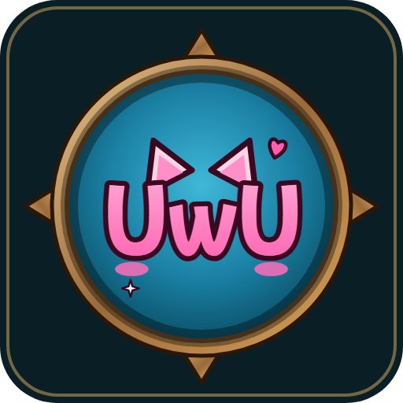
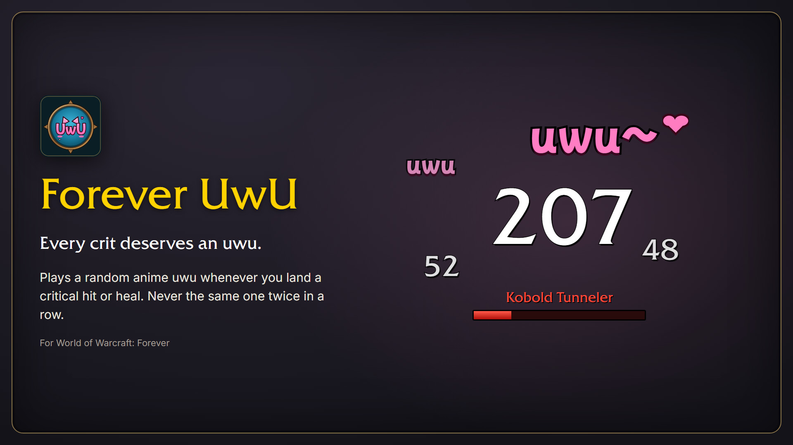
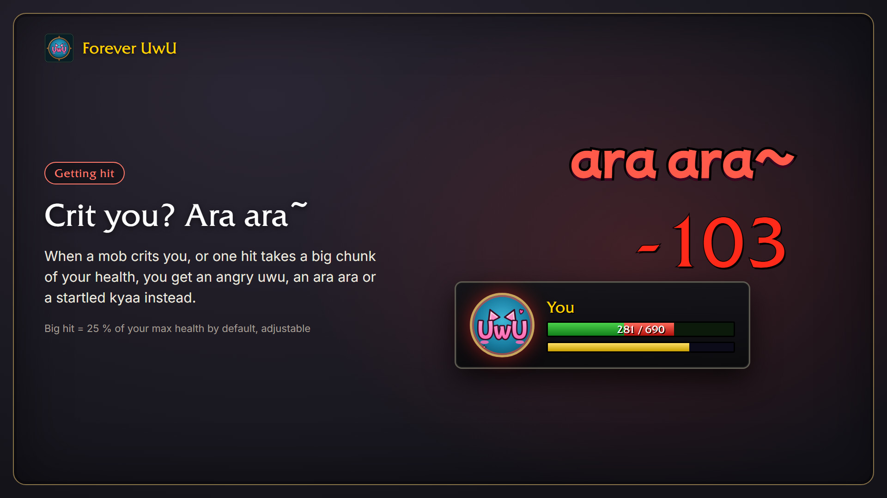
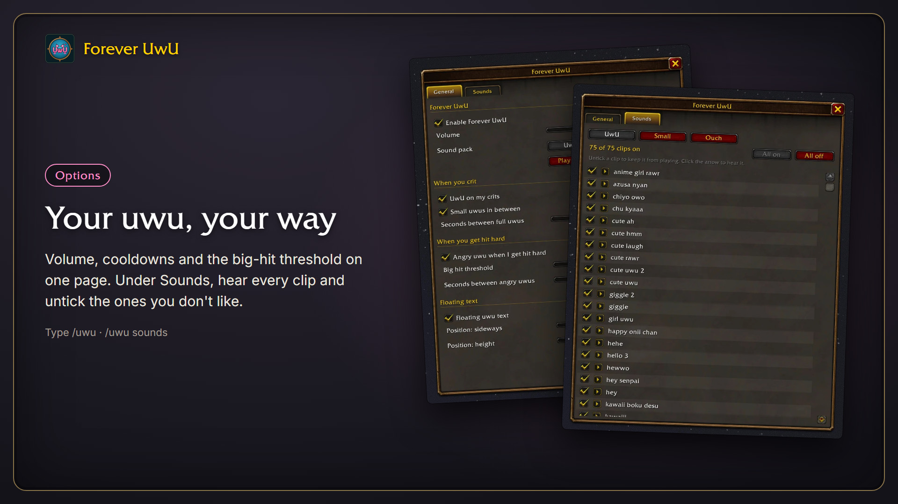

# Forever UwU

A silly little addon for **World of Warcraft: Forever**: every crit deserves an uwu.

When you crit, a random anime uwu plays and a little "uwu~" pops up over your character. Only you see it. When you get crit or take a big hit, you get an angry uwu, an ara ara or a startled kyaa. If the crits come fast, the addon plays small, quiet uwus in between so it doesn't turn into a wall of noise.

Not in the mood for uwus? Pick the **Hitmarker** sound pack. Your crits then tick like a hit marker in an old shooter, and a big hit on you cracks like a sniper rifle.

## Options

Type `/uwu`, or open **Esc > Options > AddOns > Forever UwU**. You can set the volume, pick the sound pack, switch each kind of uwu and the floating text off, and move the text. `/uwu sounds` lets you listen to every clip.

## Good to know

WoW: Forever doesn't let addons read the combat log, so the addon has to guess crits from the hit events it does get:

- Crits on mobs other than your target only count with enemy nameplates on (default key V).
- Crits from damage over time and from your pet stay silent.
- Now and then another player's crit slips through.

## Credits

Where the clips come from is listed in [CREDITS.md](https://github.com/svengabr/ForeverUwU/blob/main/CREDITS.md). The floating text uses Mochiy Pop One (SIL Open Font License).

## About me

I'm Sven. I've been a software developer for over 20 years, and I write and maintain my World of Warcraft addons in my free time. They are free and open source, and they will stay that way.

Found a bug or have an idea? Open an [issue](https://github.com/svengabr/ForeverUwU/issues) or send me a DM on [CurseForge](https://www.curseforge.com/members/conoar).

## Support

The addon is free and always will be. If it made your game a bit cuter, you can [buy me a coffee](https://buymeacoffee.com/conoar) or send something via [PayPal](https://paypal.me/svengabr).
